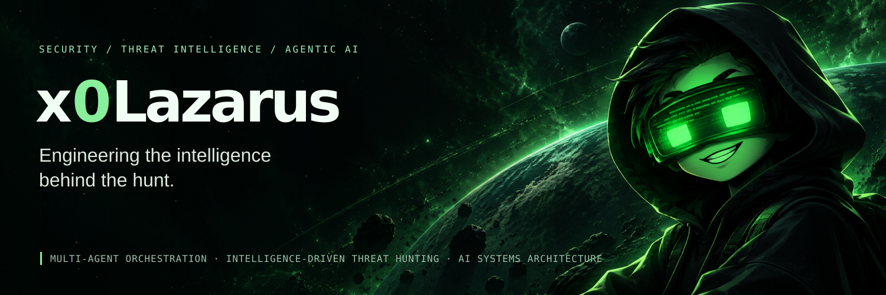
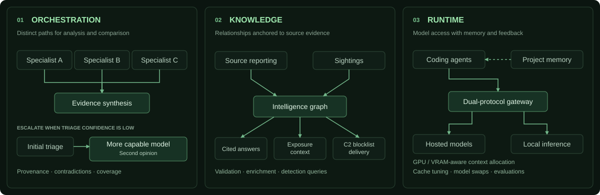

  

## Engineering AI for security investigations.

I build multi-agent analysis systems, evidence-linked intelligence platforms, and model infrastructure. My projects span how agents reason over telemetry, how intelligence becomes usable knowledge, and how local models support demanding investigative and development workflows.

<picture>
  <source media="(max-width: 600px)" srcset="assets/architecture-mobile.svg" />
  
</picture>

### Multi-agent investigation systems

**Specialist coordination, cross-model assessment, and evidence-aware decisions.**

- **Two complementary analysis paths.** Parallel specialists examine different aspects of an investigation and feed a synthesis stage. In a separate assessment path, when the initial triage model has insufficient confidence, the workflow escalates the case to a more capable model for a second assessment, giving analysts a second interpretation to compare with the initial assessment.
- **Evidence-aware correlation.** Alert telemetry, historical activity, and intelligence are correlated with source provenance, conflicting evidence, and gaps in telemetry coverage kept in view. Severity is tied to supporting evidence rather than model confidence alone.
- **Investigation-linked follow-up.** AI-generated queries extend the investigation from its existing context, helping analysts test emerging hypotheses and pursue missing evidence while retaining decision authority.

### Threat intelligence engineering

**Structured extraction, graph-grounded analysis, and detection development.**

- **Source-to-STIX pipelines.** AI-assisted article extraction produces structured intelligence, with schema and indicator validation, source-reliability checks, and evidence gates for actor dossiers. Quality audits and last-good safeguards protect previously accepted output.
- **Intelligence connected to exposure.** Sighting-driven enrichment and technology-exposure prioritization connect external reporting with what matters in an environment.
- **Automated C2 blocking.** Validated C2 indicators feed controlled blocklist delivery to network controls, with confidence and source-reliability checks and last-known-good safeguards.
- **Tool-grounded answers and hunts.** Graph queries supply evidence and citations for natural-language analysis. Sigma-to-SIEM query generation translates detection logic into platform-specific searches.

### Model infrastructure & agent tooling

**Model routing, GPU/VRAM optimization, and evaluation-driven development.**

- **A custom dual-protocol gateway.** Hosted and local models connect to coding agents through a shared gateway with dynamic model hot-swapping and request-cost visibility. Context allocation and KV-cache tuning are tailored to the available GPU and VRAM configuration.
- **Memory across context compaction.** Persistent project memory preserves working context as agent sessions compact. Automated lint and test feedback supports iterative code refinement; best-of-N selection compares multiple code candidates.
- **Workload-specific evaluation.** Benchmarks cover tool use, coding, security analysis, and memory behavior to guide model and runtime choices for the tasks they need to perform.

---

Python · Unix · Multi-agent systems · Threat intelligence · Local inference
